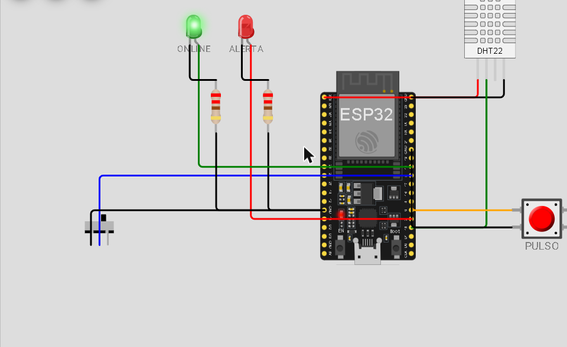
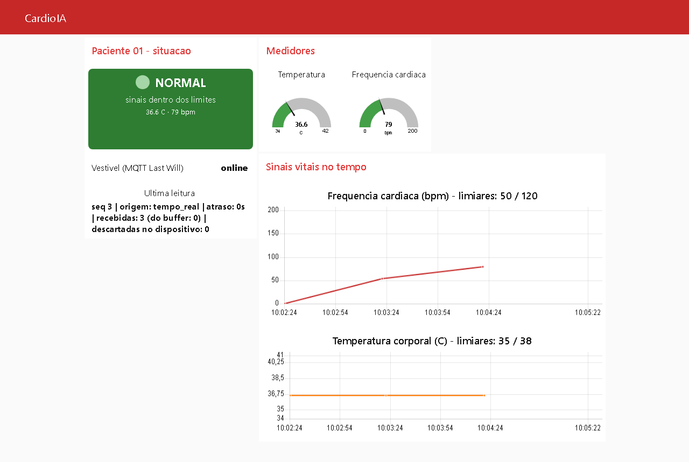
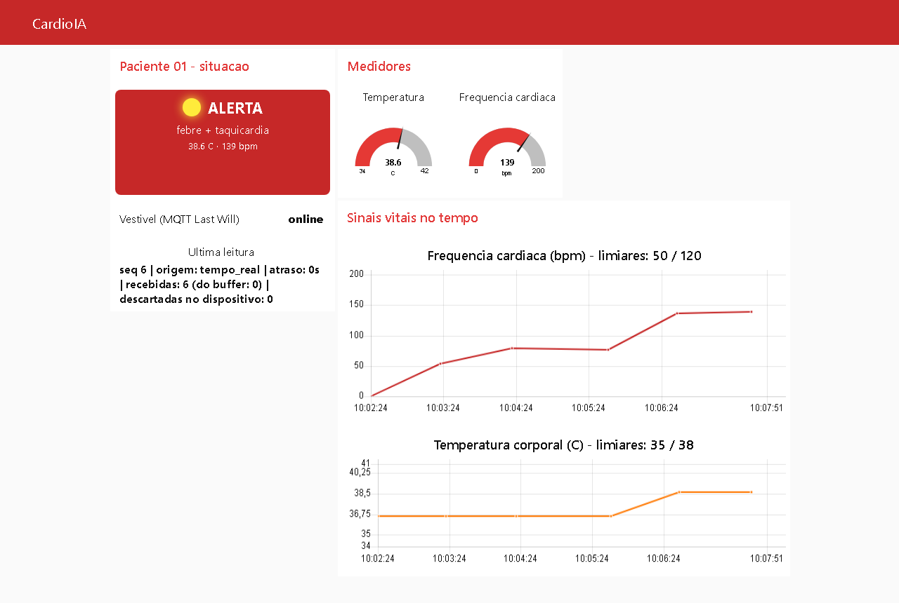
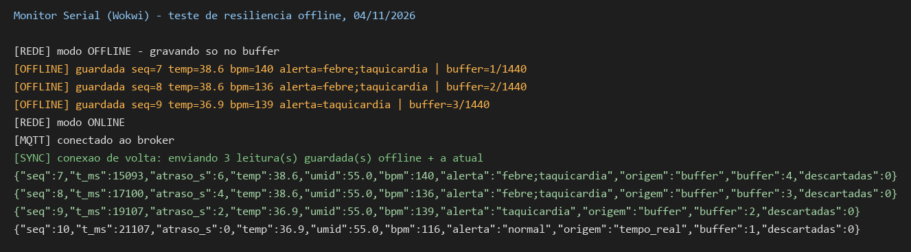
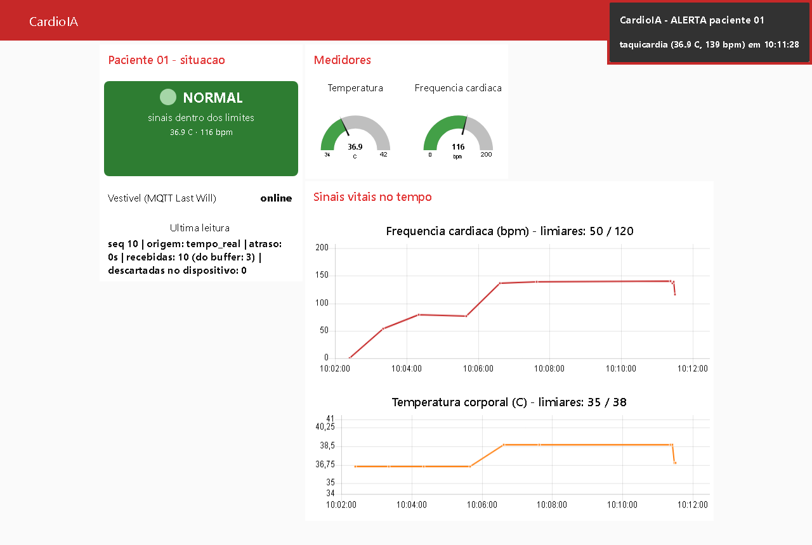

# FIAP - Faculdade de Informática e Administração Paulista

<p align="center">
<a href= "https://www.fiap.com.br/"></a>
</p>

<br>

# CardioIA — plataforma de cardiologia inteligente

## Grupo 19 (Fase 1) · Grupo 44 (Fase 2) · Grupo 78 (Fase 3) — integrante único

## 👨‍🎓 Integrantes:
- Roberto Almeida Alvares — RM568265

## 👩‍🏫 Professores:
### Tutor(a)
- <a href="https://www.linkedin.com/in/leonardoorabona/">Leonardo Ruiz Orabona</a>
### Coordenador(a)
- <a href="https://www.linkedin.com/in/andre-godoi-chiovato-83730228/">André Godoi Chiovato</a>

## ✅ Fase 3 — onde está cada item do enunciado

**Atividade: Monitoramento Contínuo – IoT na Saúde** (Cap. 1 — CardioIA Conectada).
Fluxo completo: captura → processamento → transmissão → visualização → alerta.

| Item do enunciado | Onde está |
|---|---|
| **Parte 1** · Link do projeto no Wokwi | **[wokwi.com/projects/479764753805053953](https://wokwi.com/projects/479764753805053953)** |
| **Parte 1** · Código em C++ comentado | [`src/fase3/wokwi/sketch.ino`](src/fase3/wokwi/sketch.ino) · circuito: [`diagram.json`](src/fase3/wokwi/diagram.json) |
| **Parte 1** · Mínimo de 2 sensores distintos (DHT22 obrigatório + 1 de livre escolha) | DHT22 (temperatura e umidade) + botão de pulso (batimentos → BPM) — [relatório Parte 1, seção 2](document/fase3_relatorio_parte1.md#2-sensores-mínimo-de-2-distintos) |
| **Parte 1** · Conectividade Wi-Fi simulada (variável booleana) e envio via `Serial.println` apagando o local | `wifiSimulado`, controlada por chave deslizante — [seção 4](document/fase3_relatorio_parte1.md#4-simulação-da-conectividade-a-variável-booleana) |
| **Parte 1** · Resiliência offline e estratégia de armazenamento limitado | buffer circular de **1 440 leituras = 24 h** a 1 leitura/min — [seção 5](document/fase3_relatorio_parte1.md#5-lógica-de-resiliência-offline) |
| **Parte 1** · SPIFFS (opcional) | não usado: volátil no simulador; Monitor Serial como alternativa, como o enunciado permite — [seção 5](document/fase3_relatorio_parte1.md#5-lógica-de-resiliência-offline) |
| **Parte 1** · Relatório (mín. 1 página): fluxo de funcionamento e lógica de resiliência | [`document/fase3_relatorio_parte1.md`](document/fase3_relatorio_parte1.md) |
| **Parte 2** · Envio via MQTT e integração com broker (HiveMQ) | `broker.hivemq.com`, 3 tópicos, Last Will — [relatório Parte 2, seção 2](document/fase3_relatorio_parte2.md#2-o-fluxo-de-comunicação-mqtt) |
| **Parte 2** · Dashboard Node-RED: **gráfico** do sinal vital | gráficos de BPM e de temperatura — [seção 3](document/fase3_relatorio_parte2.md#3-configuração-do-dashboard-node-red) |
| **Parte 2** · Dashboard Node-RED: **medidor (gauge)** | gauges de temperatura e de BPM |
| **Parte 2** · **Indicador visual de alerta** (> 120 bpm, > 38 °C) | LED virtual + texto, e notificação automática — [seção 3.2](document/fase3_relatorio_parte2.md#32-limites-de-alerta-definidos-pelo-grupo) |
| **Parte 2** · Código do ESP32 | o mesmo `sketch.ino` (cliente MQTT incluso) |
| **Parte 2** · Prints ou export do dashboard Node-RED | export: [`src/fase3/node-red/flow_cardioia.json`](src/fase3/node-red/flow_cardioia.json) · prints: [Evidências da Fase 3](#evidências-da-fase-3) |
| **Parte 2** · Relatório (mín. 2 páginas): fluxo MQTT e configuração do dashboard | [`document/fase3_relatorio_parte2.md`](document/fase3_relatorio_parte2.md) |
| Refletir sobre eficiência, segurança e boas práticas em IoT médico | [relatório Parte 2, seção 5](document/fase3_relatorio_parte2.md#5-eficiência-segurança-e-boas-práticas-em-iot-médico) |
| Grafana (opcional) | não usado |
| Ir Além 1 e Ir Além 2 (opcionais) | não entregues nesta fase |

## 🎥 Vídeos de demonstração

| Fase | Vídeo (YouTube, não listado) |
|---|---|
| Fase 2 — Diagnóstico Automatizado | [youtu.be/YRMtSnPapXI](https://youtu.be/YRMtSnPapXI) |

## 📜 Descrição

O **CardioIA** simula um ecossistema de cardiologia inteligente: dados clínicos,
Machine Learning, Visão Computacional, IoT e agentes de IA para triagem,
diagnóstico, monitoramento e previsão. Cada fase do curso constrói uma parte, e
todas vivem neste repositório.

### Fase 1 — A Busca de Dados

Papel de **cientista de dados hospitalar**: levantar e organizar as bases que
alimentam as fases seguintes. Base numérica com **120 pacientes e 14 variáveis
clínicas**, sem valor faltante, a partir de dados reais da *Cleveland Clinic
Foundation* (UCI Heart Disease); dois textos para NLP; e 100 laudos de ECG
(*Khan & Hussain, Mendeley Data*, DOI 10.17632/gwbz3fsgp8.2, CC BY 4.0), que
ficam fora do git por volume. O relatório completo, com o critério de amostragem
e o enquadramento de governança, está em
[`document/fase1_relatorio.md`](document/fase1_relatorio.md). O estado exato do
repositório na entrega está preservado na tag
[`fase1-entrega`](https://github.com/RobertoAlvares/A-Busca-de-Dados-Preparando-o-Terreno-para-a-Intelig-ncia-Cardiol-gica/tree/fase1-entrega).

### Fase 2 — Diagnóstico Automatizado: IA no Estetoscópio Digital

Nesta fase o sistema começa a **ler linguagem natural** — relatos de pacientes
escritos como as pessoas realmente falam.

**Parte 1 — extração de sintomas por mapa de conhecimento.** Dez relatos
simulados; um mapa `sintoma → doença` em CSV liga expressões coloquiais ("aperto
no peito", "o sapato aperta", "falha uma batida") a sete hipóteses: Infarto,
Angina, Insuficiência Cardíaca, Arritmia, Crise Hipertensiva e duas causas não
cardíacas (musculoesquelética e ansiedade). O extrator conta **expressões
distintas**, não ocorrências, e tem duas regras que mudam o resultado:

- **Negação é tratada.** "sem falta de ar" não conta como sintoma presente —
  fica registrado como *negado* e é ignorado.
- **Empate não vira diagnóstico.** Duas hipóteses com a mesma contagem geram
  `EM ABERTO`, com as concorrentes listadas.

Resultado: 10 de 10 relatos com hipótese sugerida.

**Parte 2 — classificador de risco por TF-IDF.** Dataset de **100 frases**
rotuladas em "alto risco" / "baixo risco", balanceado (50/50), vetorizado com
TF-IDF e classificado com Scikit-learn. Três modelos comparados; o principal é
escolhido pela **maior média na validação cruzada**, e não pela acurácia de uma
única divisão, porque com 25 frases de teste uma divisão só é sorte demais.

| Modelo | Acurácia no teste | Validação cruzada (5×) |
|---|---|---|
| **Regressão Logística (unigramas)** — principal | 72,0% | 81,0% ± 11,6 |
| Regressão Logística (uni + bigramas) | 72,0% | 76,0% ± 12,8 |
| Árvore de Decisão (uni + bigramas) | 60,0% | 56,0% ± 3,7 |

Matriz de confusão do modelo principal no teste (25 frases):

| | previsto alto | previsto baixo |
|---|---|---|
| **real alto** | 12 | 1 |
| **real baixo** | 6 | 6 |

Além das métricas, o script imprime as frases que o modelo errou, os termos de
maior peso em cada direção e um **teste de estresse** com 10 frases fora do
dataset (negação, apresentação atípica, intensidade, vocabulário coloquial e
contexto) — 2 das 10 divergem do esperado. Tudo é gravado em
`src/fase2/dados/saida_classificador.csv` e `saida_teste_estresse.csv`.

**Critério de rotulagem do dataset.** As frases são **simuladas** e os rótulos
seguem a lógica de sinais de alarme usada em triagem: dor torácica em repouso ou
prolongada, irradiação para braço/mandíbula/costas, síncope, falta de ar em
repouso ou ao deitar, sinais neurológicos com pressão muito alta → alto risco;
sintoma leve, localizado, com causa aparente e autolimitado → baixo risco.
**Os rótulos não foram validados por profissional de saúde.** Servem a um
exercício acadêmico, não a uso clínico.

### 🧭 Análise de padrões e distorções

**O modelo aprendeu o estilo de quem escreveu as frases, não só os sintomas.**
Os termos que mais empurram para baixo risco são "quando" e "depois" — nenhum
dos dois é sintoma. No dataset, "quando" aparece em 19 frases de baixo risco e
em 3 de alto; "depois", em 15 contra 3, porque as frases leves explicam a causa
("depois da academia"). O efeito aparece no pior erro do modelo: o único
paciente grave liberado foi *"Fiquei sem ar de repente **depois** de uma viagem
longa de avião e a panturrilha está inchada"*.

**"Não" virou sinal de gravidade.** O termo aparece em 10 frases de alto risco
("não passa", "não melhora") e em 4 de baixo, e o modelo aprendeu a ler "não"
como alarme. Por isso erra "A pressão está controlada com o remédio e não
sinto nada diferente" e as duas frases do teste de estresse com "não … dor no peito". O
TF-IDF trata a frase como um conjunto de palavras sem ordem: não percebe que o
"não" nega o sintoma. A Parte 1 acerta esses casos porque trata a negação por
regra explícita.

**A acurácia esconde o tipo de erro.** As duas regressões logísticas acertam
72%, mas o modelo principal libera 1 paciente grave e dá 6 alarmes falsos,
enquanto o outro libera 3 graves. Numa triagem, o número que importa é o
recall de alto risco (0,923 no modelo principal), não a acurácia. Com só 100
frases rotuladas por uma pessoa e variação de ±11,6 pontos na validação
cruzada, esses resultados indicam padrões, não comprovam desempenho.

### O limite que este projeto assume

Os dois módulos são **apoio à decisão, não diagnóstico**, e os scripts dizem
isso ao usuário no fim de cada execução. Dado de saúde é **dado pessoal
sensível** (LGPD, Art. 5º, II); por isso todos os relatos e frases da Fase 2 são
simulados, e nenhum dado real de paciente entra no repositório público.

### Fase 3 — Monitoramento Contínuo: IoT na Saúde

O CardioIA ganha um **vestível de monitoramento cardíaco** simulado em ESP32 no
Wokwi. Dois sensores: o **DHT22** (temperatura corporal e umidade) e um **botão
de pulso** — cada aperto é um batimento, e o ESP32 calcula a frequência cardíaca
pelos intervalos.

- **Edge (no paciente).** O ESP32 decide o alerta sozinho — febre (> 38 °C),
  taquicardia (> 120 bpm), bradicardia, hipotermia, ausência de pulso — e acende
  o LED vermelho **mesmo sem internet**. Toda leitura entra num **buffer
  circular de 1 440 registros** (24 h a 1 leitura/min). Sem conexão, ele só
  guarda; quando a conexão volta, descarrega do mais antigo para o mais novo e só
  apaga depois de enviar.
- **Cloud.** As leituras saem em JSON por **MQTT** para o broker público da
  HiveMQ, em três tópicos (`vitais`, `alerta`, `status`), com **Last Will**: se o
  vestível cair sem avisar, o broker publica `offline` por ele.
- **Fog.** Um fluxo **Node-RED** valida a leitura, recalcula o alerta com os
  mesmos limiares do dispositivo, reconstrói o horário das leituras que ficaram
  no buffer e exibe tudo num dashboard com gráficos, gauges, LED virtual de
  alerta e notificação automática.

O protótipo usa broker público sem TLS porque trafega **apenas dado simulado**;
o relatório da Parte 2 lista o que muda para dado real de paciente (TLS, ACL por
tópico, pseudônimo, segredos fora do firmware).

#### Evidências da Fase 3

| | |
|---|---|
| Circuito no Wokwi |  |
| Dashboard em estado normal |  |
| Dashboard em alerta |  |
| Dashboard com o vestível **offline** (Last Will) |  |
| Monitor Serial: modo offline e sincronização do buffer |  |
| Volta da conexão: 3 leituras do buffer recebidas e **notificação automática** de alerta |  |

Log integral do Monitor Serial da sessão de teste:
[`assets/fase3/serial_wokwi_04-11-2026.log`](assets/fase3/serial_wokwi_04-11-2026.log).

## 📁 Estrutura de pastas

Dentre os arquivos e pastas presentes na raiz do projeto, definem-se:

- <b>.github</b>: arquivos de configuração específicos do GitHub.

- <b>assets</b>: elementos não-estruturados deste repositório, como imagens.
  - `fase3/` — prints da Fase 3 (circuito, dashboard, Monitor Serial).

- <b>config</b>: arquivos de configuração usados para definir parâmetros e ajustes do projeto.

- <b>document</b>: documentos do projeto.
  - `fase1_relatorio.md` — relatório completo da Fase 1.
  - `ai_project_document_fiap.md` — documento de projeto no modelo da FIAP.
  - `fase3_relatorio_parte1.md` — Fase 3, Parte 1: fluxo e resiliência offline (edge).
  - `fase3_relatorio_parte2.md` — Fase 3, Parte 2: fluxo MQTT e dashboard (fog/cloud).

- <b>scripts</b>: scripts auxiliares para tarefas específicas.

- <b>src</b>: todo o código-fonte e os dados do projeto, por fase.
  - `fase1/dados/` — base de pacientes (120) e base completa de referência (303).
  - `fase1/textos/` — textos para NLP (Harvey, 1628; SciELO, 2019).
  - `fase2/extrator_sintomas.py` — Parte 1: extração por mapa de conhecimento.
  - `fase2/classificador_risco.ipynb` — Parte 2 em notebook: TF-IDF, classificação e avaliação, com a saída executada.
  - `fase2/classificador_risco.py` — o mesmo classificador, para rodar no terminal.
  - `fase2/dados/` — relatos, mapa de conhecimento, dataset rotulado e saídas.
  - `fase3/wokwi/` — firmware do ESP32 (`sketch.ino`), circuito (`diagram.json`) e bibliotecas (`libraries.txt`).
  - `fase3/node-red/flow_cardioia.json` — export do fluxo e do dashboard Node-RED.

- <b>README.md</b>: arquivo que serve como guia e explicação geral sobre o projeto (o mesmo que você está lendo agora).

## 🔧 Como executar o código

**Pré-requisitos:** Python 3.8 ou superior.

```bash
git clone https://github.com/RobertoAlvares/A-Busca-de-Dados-Preparando-o-Terreno-para-a-Intelig-ncia-Cardiol-gica.git
cd A-Busca-de-Dados-Preparando-o-Terreno-para-a-Intelig-ncia-Cardiol-gica
pip install -r requirements.txt
```

**Fase 2, Parte 1** — só biblioteca padrão:

```bash
cd src/fase2
python extrator_sintomas.py
```

**Fase 2, Parte 2** — requer `scikit-learn` (instalado acima):

```bash
cd src/fase2
python classificador_risco.py
```

Os resultados são reprodutíveis: divisão de treino/teste, validação cruzada e
árvore de decisão usam semente fixa (42).

**Fase 3, Partes 1 e 2 — ESP32 no Wokwi.** Abrir o [projeto no Wokwi](https://wokwi.com/projects/479764753805053953)
(ou criar um projeto ESP32 e colar os três arquivos de `src/fase3/wokwi/`) e
clicar em ▶. Controles na simulação:

- **chave deslizante** — direita = online, esquerda = offline;
- **botão PULSO** — cada aperto é um batimento (1 por segundo ≈ 60 bpm);
- **DHT22** — clicar no sensor e ajustar a temperatura (acima de 38 °C gera alerta).

**Fase 3, Parte 2 — dashboard Node-RED** (requer Node.js 18+):

```bash
npm install -g node-red
cd ~/.node-red && npm install node-red-dashboard
node-red
```

Em `http://127.0.0.1:1880`: *Menu → Import* → colar
`src/fase3/node-red/flow_cardioia.json` → *Deploy*. O dashboard fica em
`http://127.0.0.1:1880/ui` e começa a mostrar dados assim que a simulação do
Wokwi estiver rodando.

## 🗃 Histórico de lançamentos

* 0.3.0 - 04/11/2026
    * Fase 3: vestível ESP32 no Wokwi (DHT22 + pulso, alerta local, buffer
      offline de 24 h), MQTT com Last Will e dashboard Node-RED com alertas.
* 0.2.0 - 05/10/2026
    * Fase 2 completa: extração de sintomas (Parte 1) e classificador de risco
      TF-IDF com três modelos, validação cruzada e teste de estresse (Parte 2).
    * Repositório reorganizado no template oficial da FIAP, um repositório para
      todas as fases.
* 0.1.0 - 02/09/2026
    * Fase 1 entregue: bases de pacientes, textos e imagens de ECG, com
      enquadramento de governança (tag `fase1-entrega`).

## 📋 Licença

<p xmlns:cc="http://creativecommons.org/ns#" xmlns:dct="http://purl.org/dc/terms/"><a property="dct:title" rel="cc:attributionURL" href="https://github.com/agodoi/template">MODELO GIT FIAP</a> por <a rel="cc:attributionURL dct:creator" property="cc:attributionName" href="https://fiap.com.br">Fiap</a> está licenciado sobre <a href="http://creativecommons.org/licenses/by/4.0/?ref=chooser-v1" target="_blank" rel="license noopener noreferrer" style="display:inline-block;">Attribution 4.0 International</a>.</p>
